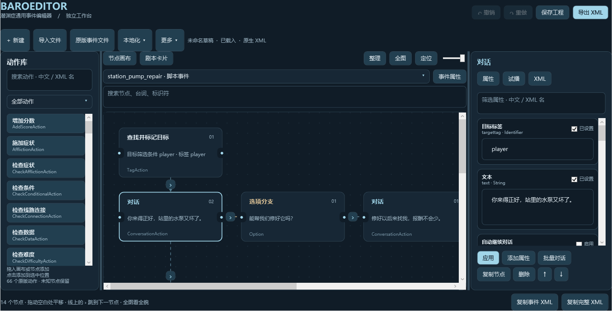

# BaroEditor | 潜渊症通用事件编辑器【独立程序】

0.2.2 预览版，Windows x64。原版 66 个动作、313 个序列化属性都有可拖动、可点击编辑的画布节点；支持原生 XML 的任意扩展节点和容器。输出仍是潜渊症事件 XML。

[Steam 独立程序订阅](https://steamcommunity.com/sharedfiles/filedetails/?id=3819572370) · [GitHub 独立下载](https://github.com/laohei-moddeveloper/baroeditor/releases/tag/v0.2.2-desktop)



## 打开

解压整个文件夹，双击 `BaroEditor.exe`。不要单独移动这个 EXE。

需要 [Microsoft .NET 10 Windows Desktop Runtime（x64）](https://dotnet.microsoft.com/en-us/download/dotnet/10.0)，已安装时直接打开即可。无需启动游戏、安装 LuaCs 或管理员运行。本程序不自动安装运行时，不加载游戏 DLL。

工坊下载：订阅后等待 Steam 完成下载，在游戏的 Steam 工坊目录打开 `Standalone/BaroEditor.exe`。仅在游戏模组列表勾选本条目不会启动独立程序。也可直接从 [GitHub Release](https://github.com/laohei-moddeveloper/baroeditor/releases) 下载独立版 ZIP。

## 可视化操作

- **动作库**：按中文、XML 名称或类别搜索；拖入节点添加子节点，拖入空白画布先成为悬空草稿，不继承选中层级。点击动作库按钮仍按当前上下文添加。复杂动作的属性使用通用面板。
- **画布**：拖动节点摆放；单击选择，双击编辑文本或子树 XML。实线表示 XML 父子/分支结构，虚线表示同级动作顺序。
- **条件**：声望检查和数据检查在节点上直接显示比较方式与比较值；选择 `gt/gte/eq/neq/lt/lte`，输入值后点击 ✓，写回原版 `condition` 属性。未知写法在原始属性/XML 中保留。
- **GoTo**：点击“定位目标”跳到同一事件中同名 Label；重名时选择目标，缺失时提示。选中或悬停 GoTo/Label 用边框对应高亮，普通连线高亮两端。
- **悬空草稿**：可以编辑、互相连接并保存工程；连入事件后才进入原生 XML。将整段悬空顺序链的起点连接到事件时会带入后续动作。“更多”可以把选中动作移为悬空草稿。导出、复制或覆盖时若仍有悬空草稿，会提醒只输出已连接的内容；确认前请先保存工程，防止丢失未连接工作。
- **结构限制**：事件组 EventSet 和脚本事件 ScriptedEvent/TraitorEvent 不能嵌套在事件内部。新增、连线会拒绝这种结构；导入原文保留并警告，修正前阻止输出 XML。
- **连接**：拖动右侧输出圆点到目标左侧输入圆点，连接默认分支；点击输出圆点可选择成功、失败、选项、中断或下一动作。连接会移动目标及其整个子树，可撤销。XML 树拒绝循环，已有成功/失败容器会复用。
- **剧本卡片**：包含所有动作，不只显示对话。同级卡片可拖动排序；跨分支用画布连接。对话额外支持每行一句的批量编辑。
- **属性**：中文名与 XML 名一起显示；搜索筛选，支持原版默认值、枚举提示、未知属性及多行文本。未启用的属性不写入 XML。
- **试播**：可逐步查看通用事件流程；条件分支由你选择。不执行游戏效果或脚本，不等同于游戏运行验证。
- **本地化**：点击“本地化 ▾”导入原版或模组的 `infotexts` XML（可多选），切换语言。卡片、节点搜索、试播和属性预览使用译文；编辑与导出保留原始标签。支持静态 `Text/Replace` 预览，运行时变量保留占位符。词条内嵌保存到工程，恢复时无需读取外部文件。同文件重复标签确定性取首项，后导入文件覆盖先前词条。
- **导入**：读取你选择的原版或模组 XML 文件；支持整份文件、多事件选择、事件搜索、粘贴 XML 和工程恢复。原文、注释、未知节点及命名空间会保留。

拖动空白处平移画布，中键或空格+拖动也可平移；Ctrl+滚轮围绕指针缩放。“整理”自动布局，“全图”按节点实际范围缩放（最低 0.1%），“定位”以 100% 阅读选中节点。点击连线或线上的 › 跳转点可定位下一节点，导航不改变 XML。Ctrl+O 导入，Ctrl+S 保存工程，Ctrl+Shift+S 导出 XML。文本框中的 Ctrl+Z 撤销输入，工作区的 Ctrl+Z 撤销操作。

## 保存与权限

工程 `.baroeditor` 保存完整 XML、独立悬空草稿、节点位置与导入的本地化词条。带悬空节点时使用工程格式 2，需要 0.2.2 或更高版本；旧版工程可继续导入。工程恢复不会自动读取项目外的源文件。默认导出 XML 副本到 `%LOCALAPPDATA%/BaroEditor/Exports`；同名输出保留 `.previous`。复制到剪贴板的 XML 带换行、缩进，并保留对话内换行。

高级源文件覆盖只对你明确导入的文件可用，另行确认，先备份并检测外部变化。备份位于 `%LOCALAPPDATA%/BaroEditor/Backups`。原版 Content、DLC 和 Steam 工坊缓存保持只读。

没有网络请求、遥测、目录扫描、进程注入或导入事件执行。只读取所选文件和本程序动作目录；只有点击复制才写剪贴板。路径保护是程序行为，不是操作系统沙箱。

## 性能与范围

搜索采用 180 ms 延迟过滤及 XML 修改版本索引缓存。拖动只更新位置和关联连线，不逐帧解析 XML。画布一次最多显示 400 个节点，搜索可找到靠后的节点；新增/选中节点在显示上限之外也会保留。事件选择列表虚拟化。

本地化一次最多导入 64 个文件、48 MiB，每文件 8 Mi 字符；总词条最多 100,000 个、16 Mi 字符。导入在后台读取，失败保留已载入的词条；禁用 DTD 与外部实体。

XML 上限 8 MiB、50,000 个元素、96 层。操作历史最多 24 项，XML 历史预算 8 MiB。对话、连线和通用属性不代替游戏对事件组合的要求。动作目录来自 1.13.4.0；新增游戏或模组节点可继续按原名通用编辑。文件保留是结构与语义保留，序列化可能改变编码、引号或空元素形式。

已通过 229 项独立版核心检查、671 项 XML 回归检查，以及实际 WPF 回调与渲染检查（汉化搜索、添加动作、属性应用、分支连接、布局撤销、工程恢复、空结果、100 节点全图适配、连线跳转与本地化）。0.2.2 新增悬空草稿、连接/撤销/工程恢复、比较条件、标签作用域与结构限制的核心检查；本次未进行新增界面的人工实测。复杂事件执行、所有分辨率和输入设备尚未充分验证，因此作为预览版发布。

## 游戏内版

需要在原版事件编辑器里工作时，可使用 [BaroEditor 游戏内版](https://steamcommunity.com/sharedfiles/filedetails/?id=3819517380)。它需要 LuaCs，提供游戏已加载事件载入与原版节点图对接。两个版本通过原生 XML 文件或复制粘贴互通，不要求同时安装。

## 开发

Windows + .NET 10 SDK 可运行：

```powershell
dotnet publish BaroEditor.Desktop.csproj -c Release --self-contained false -o C:/temp/BaroEditorDesktop
dotnet run --project tests/BaroEditor.Tests.csproj -- C:/temp/BaroEditorTests Assets/actions.json D:/steam/steamapps/common/Barotrauma/Content/Events C:/temp/action-catalog.json
```

SDK 构建的入口名为 `BaroEditor.Desktop.exe`。没有 SDK 时可使用已有 Roslyn 与已安装的桌面运行时，通过 `tools/build.ps1` 编译；Roslyn 仅用于开发，不进入发布包。发布构建不含 UI 测试入口或测试程序集。

MIT License。独立社区工具，非游戏官方组件。
