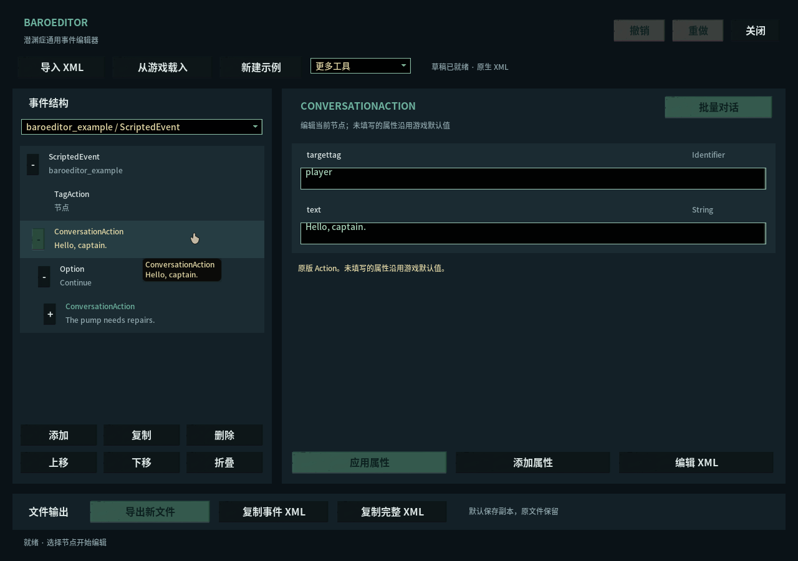

# BaroEditor|潜渊症通用事件编辑器

在潜渊症原版事件编辑器中，用 XML 树和属性面板编辑事件，减少手写层层嵌套的对话。输出仍是游戏原生 XML，不引入新的事件运行格式。

**0.1.1 预览版：离线检查及游戏内基础界面、Action 元数据检查通过。复杂事件运行和完整节点图往返尚未充分验证。**



[Steam 创意工坊订阅](https://steamcommunity.com/sharedfiles/filedetails/?id=3819517380) · [GitHub 发布下载](https://github.com/laohei-moddeveloper/baroeditor/releases)

## 两个版本

| 版本 | 适合的用法 | 下载 |
| --- | --- | --- |
| 游戏内 | 在原版事件编辑器工作，需 LuaCs | [工坊](https://steamcommunity.com/sharedfiles/filedetails/?id=3819517380) · [v0.1.1](https://github.com/laohei-moddeveloper/baroeditor/releases/tag/v0.1.1) |
| 独立程序 | 所有动作的拖动画布，Windows 程序，无需开游戏 | [工坊](https://steamcommunity.com/sharedfiles/filedetails/?id=3819572370) · [v0.2.2](https://github.com/laohei-moddeveloper/baroeditor/releases/tag/v0.2.2-desktop) |

两版通过原生 XML 文件或复制粘贴互通，不要求同时安装。[独立版完整说明](Desktop/BaroEditor/README.md)。

下面是游戏内版的说明。

## 功能

- 导入指定 XML 文件，或载入游戏已经加载的 ScriptedEvent / TraitorEvent；在原内容上修改。
- 浏览整份文件或单个事件，折叠子树，修改属性，添加、复制、移动、删除节点；支持撤销与重做。
- 动态读取当前游戏程序集中的原版 Action 和属性提示。本地 1.13.4.0 核对到 66 个具体 Action、313 个序列化属性。
- 所有 XML 节点均可通过树、属性或子树 XML 编辑，保留未知属性、扩展节点、注释及结构。通用编辑不代表每一种复杂 Action 都有专用向导，也不保证错误组合能被游戏执行。
- 批量编辑连续对话，每行一句；保留已有选项、分支和动作。存在结构化 Text 替换时使用 XML 编辑；缩短现有对话链须明确删除节点。
- 可将选中事件送入原版节点图；该图的导出能力取决于游戏，从图重新载入前会提示替换草稿。
- 原版游戏 UI，中文与英文界面；不改变游玩时的对话外观。

- 动作与属性显示中文，保留 XML 原名；事件、节点、台词、动作和属性支持中英文搜索。
- 剪贴板 XML 带换行与缩进；搜索使用延迟过滤及修改版本缓存。

## 安装与打开

需要 Barotrauma 客户端和 [LuaCsForBarotrauma](https://steamcommunity.com/sharedfiles/filedetails/?id=2559634234)，并按 LuaCs 的说明安装客户端运行支持、允许 C# 模组。

把发布包中的 `BaroEditor` 文件夹放进游戏 `LocalMods`，在模组列表启用 LuaCs 与 BaroEditor。回到主菜单，按 F3 输入 `baroeditor` 或 `beditor`。原版事件编辑器右上角也会出现 BaroEditor 入口。工具只在主菜单和事件编辑器打开。启用模组后若命令尚未注册，先输入 `cl_reloadluacs`，或重启游戏。旧命令 `barodialogue` / `bdialogue` 仍兼容。

本工具不要求服务器安装。发布包不会替你修改游戏 DLL、LuaCs 配置或全局 C# 运行策略。

## 编辑后存到哪里

**默认导出新文件，不修改导入的源文件。**

| 操作 | 结果 |
| --- | --- |
| 导出新文件 | 整份 XML 写入 `%LOCALAPPDATA%/BaroEditor/Exports`；同名旧导出保留为 `.previous` |
| 复制事件 XML | 将当前选中事件复制到剪贴板 |
| 复制整文件 XML | 将完整草稿复制到剪贴板 |
| 高级：覆盖源文件 | 仅显式导入的本地文件可用，另行确认；先备份，再检测外部修改 |

覆盖备份存于 `%LOCALAPPDATA%/BaroEditor/Backups`。从游戏内存或节点图载入的事件只能导出或复制。工具拒绝通过已知游戏 Content、DLC 路径和 Steam 工坊缓存路径覆盖；请先复制到自己的本地模组项目。文件路径保护是编辑器措施，不是操作系统安全边界。

导出的 XML 需由你放入模组，并在该模组的 `filelist.xml` 中注册为事件资源。编辑或预览不会直接运行事件，也不会替你覆盖原版事件。

## 性能与访问范围

没有网络请求、遥测、后台目录扫描或事件执行。只读取你指定的文件及游戏已加载的数据；剪贴板仅在点击复制时写入。读写范围和 C# 宿主的实际权限详见 [访问范围](docs/ACCESS.md)。

XML 上限 8 MiB、50,000 个元素、96 层；撤销最多 24 次，XML 快照预算 8 MiB。超过单次历史预算的编辑不能撤销。树一次最多显示 1,200 行，超限时选择单个事件或折叠分支。Action 信息按需缓存，XML 编辑由操作触发，不逐帧处理。

已完成结果及未充分验证的场景见 [验证记录](docs/VALIDATION.md)。

## 开发

运行包只含 `CSharp`、`ModConfig.xml`、`filelist.xml` 与说明文件。`tools`、`tests` 和任何游戏 DLL 不进入工坊包。

Windows 上可使用游戏随附 Roslyn / Mono.Cecil 进行编译检查，无须安装 SDK：

```powershell
./tools/verify_compile.ps1 -GameRoot 'D:/steam/steamapps/common/Barotrauma' -Scratch 'C:/temp/bd-compile'
dotnet 'C:/temp/bd-compile/BaroEditor.Tests.dll' 'C:/temp/bd-test' 'D:/steam/steamapps/common/Barotrauma/Content/Events'
./tools/verify_catalog.ps1 -GameRoot 'D:/steam/steamapps/common/Barotrauma' -Output 'C:/temp/bd-actions.json'
./tools/package.ps1 -Output 'C:/temp/bd-release'
```

有 .NET 8 SDK 时，可单独运行核心测试：`dotnet run --project tests/CoreTests.csproj -- C:/temp/bd-test`。测试不会启动游戏。隔离游戏测试工具见 [验证记录](docs/VALIDATION.md)，只用于开发，不能复制进正式模组。

MIT License。Barotrauma 与 LuaCs 是各自作者的项目，本工具为独立社区工具。

## English

BaroEditor adds an XML tree and property editor to Barotrauma's vanilla event editor. Import existing event XML, inspect and edit any node, discover native Actions, batch-edit simple dialogue chains, undo/redo, export a new file, or explicitly copy XML. The output remains native event XML.

Version 0.1.1 is a preview: offline checks, basic in-game windows and native Action metadata passed. Complex event execution and complete vanilla graph round trips have not been fully validated. Complex Actions use generic attributes and subtree XML, rather than dedicated visual wizards. The vanilla graph exporter may omit content; the canonical XML draft is retained separately.

Requires the client-side LuaCs runtime with C# mod support. Enable LuaCs and BaroEditor, return to the main menu, press F3 and run `baroeditor`. Default export: `%LOCALAPPDATA%/BaroEditor/Exports`. Source overwrite is a separate confirmed operation with backup and change detection. There is no networking, telemetry, scanning, or execution of imported events. LuaCs C# plugins are trusted code; these access limits are application behavior, not an OS sandbox.
